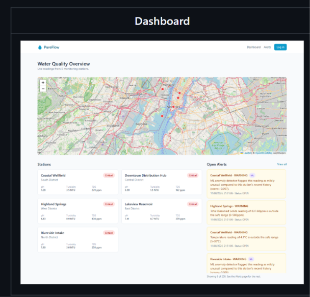

# AquaTrace water-quality overview reference

## First-draft visual direction

The user identified https://beady.ai/ as the visual direction for the first draft. Inspect the live site visually before designing; the initial browser preview timed out, so its exact colours, typography, spacing and motion have not yet been verified. Combine that reference with the user's preference for a clean, predominantly white interface and the AquaTrace dashboard requirements below. Use the reference as inspiration, not as a source of product claims or data.

Status: user-requested UI feature reference, saved 2026-11-03.

Read this note and inspect the screenshot when implementing the AquaTrace dashboard. This is one feature within AquaTrace, not a replacement for the upstream network trace, complaint intake, or case workflow.

## What the reference shows

- A water-quality overview heading and short monitoring summary.
- A wide monitoring-station map as the main visual, with location markers and zoom controls.
- A Stations section below the map, with compact cards arranged in a grid.
- Each station card includes its name, district, severity badge, and current pH, turbidity, and TDS readings with units where applicable.
- An Open Alerts column beside the station grid, with station name, severity, explanation, timestamp, status, and a View all action.
- A restrained layout with readable spacing, light surfaces, and clear warning/critical states.

## How to apply it to AquaTrace

Preserve the map-first overview and the station/alert relationship. Adapt typography, surfaces, and colors to the project's selected semantic theme; this screenshot does not select a new global theme. Use AquaTrace branding instead of PureFlow. The dark outer frame and large Dashboard title belong to the reference presentation, not the application chrome.

Implementation guidance derived from the AquaTrace brief:

- Connect station selection to node details: readings, WQI breakdown, chlorine forecast, maintenance, complaints, and linked cases.
- Connect alerts to case evidence and status history. Show the reading, baseline or configured limit, and rule behind a flag.
- Include residual chlorine and WQI when appropriate for AquaTrace, in addition to the screenshot's parameters.
- Keep the dedicated network view and Trace upstream action available; the geographic overview does not replace pipe connectivity.
- Label the seeded data as synthetic sample data. Do not reuse the screenshot's station names, measurements, or alert text as verified facts.
- Retain the brief's human-judgment disclaimer and distinguish automated suggestions from official decisions.
- Keep the overview usable offline. Any geographic basemap needs an offline-compatible fallback; network tracing must not depend on online tiles.
- On narrow screens, stack the map, station cards, and alerts. Pair severity colors with text labels.

## Implementation review checklist

- [ ] Monitoring overview includes a prominent map, station cards, and open alerts.
- [ ] Station cards display names, locations, labeled measurements, and severity.
- [ ] Station and alert selections open the relevant detail/evidence views.
- [ ] Synthetic-data labeling and the human-judgment disclaimer remain visible.
- [ ] Theme tokens, responsive layout, and offline behavior are respected.

Source: screenshot supplied by the user in chat. Saved locally so future work does not depend on the temporary clipboard file.
